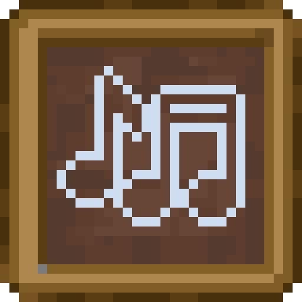

<!-- PROJECT BADGES -->
<div align="center">

[![Packagist][packagist-badge]][packagist-url]
[![CI][ci-badge]][ci-url]
[![Stars][stars-badge]][stars-url]
[![License][license-badge]][license-url]

</div>


<!-- PROJECT LOGO -->
<br />
<div align="center">
  
  <h3>play-sound-utils</h3>
  <p align="center">
    Play any vanilla or custom sound to players in one line.

[Packagist][packagist-url] · [Changelog](CHANGELOG.md) · [Report a bug][issues-url] · [Request a feature][issues-url]

  </p>
</div>

```php
PlaySound::sendTo($player, VanillaPlaySounds::LEVELUP);                 // to one player, at their position
$world->addSound($position, VanillaPlaySounds::MOB_CREEPER_SAY());     // to everyone near a position
```

-----

## 🌟 Why play-sound-utils?

Sending a sound by its string name means building a `PlaySoundPacket` by hand: coordinates, volume, pitch, and
(since Bedrock 1.26.60) three more fields. This library wraps all of it, so the same one-liner keeps working when
the packet changes:

- **One line per job** : to one player, to many players, or through `World::addSound()`
- **Real `Sound` objects** : `PlaySound` implements `pocketmine\world\sound\Sound`, so the world decides who hears it
- **All vanilla sounds included** : every sound of Bedrock 1.26.60.5 as a typed method (`VanillaPlaySounds::LEVELUP()`)
  or a constant for the raw name (`VanillaPlaySounds::LEVELUP`), grouped by category
- **Up to date with the protocol** : supports the 1.26.60 `PlaySoundPacket` with loop count, listener range bypass and
  playback position
- **Safe to call** : disconnected players are skipped instead of throwing
- **Small phars** : an optional build tool strips every sound your plugin does not use
- **Tested** : run against the real server code on PHP 8.4 / 8.5

## 🎯 Use cases

| You are building...                           | Use                                                  |
|-----------------------------------------------|------------------------------------------------------|
| Feedback sounds (level up, error, click)      | `PlaySound::sendTo()`                                |
| Minigame events for everyone in an arena      | `PlaySound::broadcastTo()`                           |
| Sounds at a block or entity position          | `World::addSound()` with a `PlaySound`               |
| Looping ambience or music                     | `loopCount` and `playbackPositionSeconds`            |
| Sounds from a resource pack (custom sounds)   | `new PlaySound("your.custom.sound")`                 |

-----

## 📦 Installation

```sh
composer require presentkim/play-sound-utils
```

| Requirement | Version                                                           |
|-------------|-------------------------------------------------------------------|
| Server      | [axolotl-pm/PocketMine-MP][axolotl-url] (fork of PocketMine-MP 5) |
| PHP         | **8.4** or newer                                                  |

> The Poggit virion for the original PocketMine-MP 5.44 and older is kept on the
> [`legacy/pmmp-5.44`][legacy-url] branch (no longer maintained).

-----

## 🚀 Quick start

All classes are in `kim\present\utils\playsound`.

```php
use kim\present\utils\playsound\PlaySound;
use kim\present\utils\playsound\VanillaPlaySounds;

// 1. To one player (at the player's position)
PlaySound::sendTo($player, "random.levelup");

// 2. To several players
PlaySound::broadcastTo($players, "random.levelup", volume: 0.8, pitch: 1.2);

// 3. Through the world: the world sends it to the players who can hear it
$world->addSound($position, new PlaySound("random.levelup"));

// 4. A vanilla sound without typing its name
$world->addSound($position, VanillaPlaySounds::LEVELUP());
```

### Sound options

`PlaySound` is a mutable value object. Every option is a constructor argument and has a fluent setter:

```php
$sound = new PlaySound("music.game", volume: 0.5, pitch: 1.0, loopCount: 3, playbackPositionSeconds: 12.5);

$sound->setVolume(1.0)->setPitch(0.9)->setBypassListenerRangeCheck(true);

$sound->send($player);            // at the player's position
$sound->send($players, $vec);     // at a position, to a list of players
```

> `VanillaPlaySounds::XXX()` returns a **new copy** each time, so changing it never affects other callers.

-----

## 📚 Examples

<details open>
<summary><b>Sounds with <code>World::addSound()</code></b></summary>

```php
use kim\present\utils\playsound\PlaySound;
use pocketmine\math\Vector3;
use pocketmine\world\World;

function sendCustomSound(World $world, Vector3 $vec) : void{
    $world->addSound($vec, new PlaySound("random.levelup", volume: 0.8, pitch: 1.2));
}
```

</details>

<details>
<summary><b>Build the packet yourself</b></summary>

```php
use kim\present\utils\playsound\PlaySound;

// Optional trailing parameters: serverSoundHandle, loopCount, bypassListenerRangeCheck, playbackPositionSeconds
$packet = PlaySound::createPacket($vec, "random.levelup", volume: 1.0, pitch: 1.0);
$player->getNetworkSession()->sendDataPacket($packet);
```

</details>

<details>
<summary><b>Looping a sound and starting in the middle</b></summary>

```php
// Repeats 3 times and starts 30 seconds into the track
$music = (new PlaySound("music.game"))
    ->setLoopCount(3)
    ->setPlaybackPositionSeconds(30.0);

$music->send($player);
```

</details>

<details>
<summary><b>Constants or methods?</b></summary>

```php
use kim\present\utils\playsound\VanillaPlaySounds;

$name  = VanillaPlaySounds::LEVELUP;   // string "random.levelup": for sendTo() / broadcastTo() / createPacket()
$sound = VanillaPlaySounds::LEVELUP(); // PlaySound object: for World::addSound() / send()
```

Category traits are generated under `kim\present\utils\playsound\defaults`
(category `ui` becomes `VanillaPlaySoundsUiTrait`) and are composed into the final `VanillaPlaySounds` class.

</details>

-----

## 📖 API reference

### `PlaySound`

| Member                                                                                        | Description                                                                       |
|-----------------------------------------------------------------------------------------------|-----------------------------------------------------------------------------------|
| `new PlaySound(string $soundName, float $volume = 1.0, float $pitch = 1.0, ?int $serverSoundHandle = null, int $loopCount = 0, bool $bypassListenerRangeCheck = false, ?float $playbackPositionSeconds = null)` | Create a sound. Implements `pocketmine\world\sound\Sound` |
| `getSoundName()` / `setSoundName(string)`                                                     | Sound name, e.g. `random.levelup`                                                 |
| `getVolume()` / `setVolume(float)`                                                            | Volume, based on 1.0                                                              |
| `getPitch()` / `setPitch(float)`                                                              | Pitch, based on 1.0                                                               |
| `getServerSoundHandle()` / `setServerSoundHandle(?int)`                                       | Optional sound handle (added in 1.26.20)                                          |
| `getLoopCount()` / `setLoopCount(int)`                                                        | How many times the client repeats the sound, `0` plays it once (new in 2.0.0)     |
| `isBypassListenerRangeCheck()` / `setBypassListenerRangeCheck(bool)`                          | Play even if the client is out of listener range (new in 2.0.0)                   |
| `getPlaybackPositionSeconds()` / `setPlaybackPositionSeconds(?float)`                         | Position in seconds to start playback from, `null` for the start (new in 2.0.0)  |
| `encode(Vector3 $pos) : PlaySoundPacket[]`                                                    | The packet list used by `World::addSound()`                                       |
| `send(Player\|Player[] $recipients, ?Vector3 $vec = null) : void`                             | Send to one or more players. `$vec` null plays at each player's own position. Disconnected players are skipped |
| `static sendTo(Player $player, string $soundName, float $volume = 1.0, float $pitch = 1.0) : void` | Send by name at the player's position. Does nothing if disconnected          |
| `static broadcastTo(Player[] $recipients, string $soundName, float $volume = 1.0, float $pitch = 1.0) : void` | `sendTo()` for each player                                  |
| `static createPacket(Vector3 $vec, string $soundName, float $volume = 1.0, float $pitch = 1.0, ?int $serverSoundHandle = null, int $loopCount = 0, bool $bypassListenerRangeCheck = false, ?float $playbackPositionSeconds = null) : PlaySoundPacket` | Build the packet only |

All setters return `$this`.

### `VanillaPlaySounds`

Every vanilla sound name is available twice: `VanillaPlaySounds::NAME` (string constant) and
`VanillaPlaySounds::NAME()` (new `PlaySound`). Names are the sound name in upper case with dots replaced by `_`
(`mob.zombie.say` becomes `MOB_ZOMBIE_SAY`); where it does not collide, a shorter alias without the first segment is
also generated (`ZOMBIE_SAY`). The list is for Bedrock **1.26.60.5**.

-----

## ✂️ Trimming unused sounds from your phar

`VanillaPlaySounds` holds thousands of constants and methods. If your plugin uses a handful of them, the bundled copy
is dead weight. The prune tool rewrites your built plugin phar so it only keeps the members that are actually used:

- removes the generated `VanillaPlaySounds*Trait` files
- inlines only the used constants and methods into the `VanillaPlaySounds` class

It reads the PHP files inside the phar, so it must run **after** the plugin phar is built with its vendor libraries
(namespace-shaded or not). The class is found by its short name, so a shaded name such as
`MyPlugin\libs\kim\present\utils\playsound\VanillaPlaySounds` works, and so do `use ... as Alias;` imports and
constant uses (`VanillaPlaySounds::LEVELUP`).

### Usage

The tool is installed as a Composer bin. `phar.readonly` must be disabled:

```sh
# one phar
php -d phar.readonly=0 vendor/bin/prune-vanilla-play-sounds-phar.php .releases/MyPlugin.phar

# every .phar in a directory, or a glob
php -d phar.readonly=0 vendor/bin/prune-vanilla-play-sounds-phar.php .releases
php -d phar.readonly=0 vendor/bin/prune-vanilla-play-sounds-phar.php ".releases/*.phar"
```

- The phar is replaced in place. If it is locked (e.g. on Windows), the result is written next to it as
  `MyPlugin.trimmed.phar`.
- A phar that does not contain `VanillaPlaySounds` is left untouched.
- Only sounds referenced **statically** are kept. If you build sound names dynamically
  (`constant("VanillaPlaySounds::$name")`), do not prune, or pass plain strings to `PlaySound` instead.

### In a release build

Run it as the last step, after the plugin phar has been built and the vendor libraries have been shaded into it.
Example for GitHub Actions:

```yaml
      - name: Install dependencies
        run: composer install --no-dev --optimize-autoloader

      - name: Build the plugin phar (shading vendor libraries)
        run: php -d phar.readonly=0 build/build-phar.php   # your own build script

      - name: Prune unused VanillaPlaySounds entries
        run: php -d phar.readonly=0 vendor/bin/prune-vanilla-play-sounds-phar.php .releases
```

If the build does not keep `vendor/` around, download the tool instead (both files are required, side by side):

```sh
base=https://raw.githubusercontent.com/presentkim-pm/play-sound-utils/main/tools
wget -P tools "$base/prune-vanilla-play-sounds-phar.php" "$base/PruneVanillaPlaySounds.php"
php -d phar.readonly=0 tools/prune-vanilla-play-sounds-phar.php .releases
```

-----

## 🔄 Regenerating the sound list

`VanillaPlaySounds` and its category traits are generated from Mojang's
[`sound_definitions.json`](https://github.com/Mojang/bedrock-samples/blob/main/resource_pack/sounds/sound_definitions.json).
To update them for a new Bedrock version:

```sh
php build/VanillaPlaySounds.generator.php
```

The script downloads the latest `version.json` and `sound_definitions.json` from `Mojang/bedrock-samples`
(so it needs network access), then rewrites `src/kim/present/utils/playsound/VanillaPlaySounds.php` and every trait in
`src/kim/present/utils/playsound/defaults/` from the two templates in `build/`. Do not edit the generated files by hand.

-----

## 🧪 Development

```sh
composer install --ignore-platform-req='ext-*'
composer test
```

The tests run against the real `axolotl-pm/pocketmine-mp` code without its native extensions.

-----

## 📄 License

Distributed under the **MIT** License. See [LICENSE][license-url] for more information.


[packagist-badge]: https://img.shields.io/packagist/v/presentkim/play-sound-utils.svg?style=for-the-badge

[packagist-url]: https://packagist.org/packages/presentkim/play-sound-utils

[ci-badge]: https://img.shields.io/github/actions/workflow/status/presentkim-pm/play-sound-utils/ci.yml?branch=main&style=for-the-badge

[ci-url]: https://github.com/presentkim-pm/play-sound-utils/actions/workflows/ci.yml

[stars-badge]: https://img.shields.io/github/stars/presentkim-pm/play-sound-utils.svg?style=for-the-badge

[stars-url]: https://github.com/presentkim-pm/play-sound-utils/stargazers

[license-badge]: https://img.shields.io/github/license/presentkim-pm/play-sound-utils.svg?style=for-the-badge

[license-url]: https://github.com/presentkim-pm/play-sound-utils/blob/main/LICENSE

[issues-url]: https://github.com/presentkim-pm/play-sound-utils/issues

[legacy-url]: https://github.com/presentkim-pm/play-sound-utils/tree/legacy/pmmp-5.44

[axolotl-url]: https://github.com/axolotl-pm/PocketMine-MP
